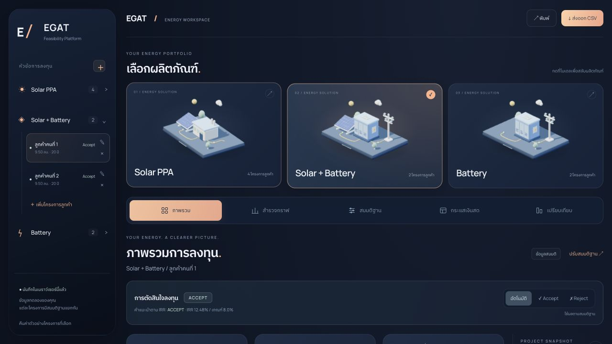

# EGAT Energy Workspace · V4

เว็บไซต์หลักอันที่ 2 ของ EGAT Feasibility Platform พัฒนาต่อจากต้นแบบ Workspace V4
(branch `design/workspace-v4` ของ repo หลัก) — **แยกขาดจากเว็บหลักทุกส่วน**

| ส่วน | V4 (repo นี้) | เว็บหลัก (ห้ามแตะ) |
|---|---|---|
| โค้ด | `funaturalstone/egat-workspace-v4` (private) | `funaturalstone/Egat-feasibility` |
| ฐานข้อมูล | Supabase `EGAT-Workspace-V4` · `hdreqbadncphcxlyxfrh` · Singapore | `EGAT-Feasibility` · `btbivrzhzqylmmfdgiji` |
| โฮสต์ | Vercel project `egat-workspace-v4` | Vercel project `egat-feasibility` |



## ทำอะไรได้
- เลือกผลิตภัณฑ์ Solar PPA / Solar + Battery / Battery จากโมเดล 3 มิติ (Three.js)
- จัดการโครงการลูกค้าใน sidebar: เพิ่ม เปลี่ยนชื่อ ลบ เลิกทำ
- ภาพรวม สำรวจกราฟ สมมติฐาน กระแสเงินสด และเปรียบเทียบ ด้วยเอนจินคำนวณชุดเดียวกับเว็บหลัก (`domain/`)
- การตัดสินใจ Auto / Accept / Reject แยกตามลูกค้า
- **เข้าสู่ระบบ** แล้วโครงการบันทึกบนคลาวด์อัตโนมัติ เห็นได้เฉพาะบัญชีตัวเอง หรือใช้ **โหมดทดลอง** (เก็บในเบราว์เซอร์)

## โครงสร้าง
- `index.html` `landing.js` `landing.css` — หน้าแรก (landing) · ปุ่มทดลองใช้งานเปิด `/app?demo`
- `app.html` `app.js` `style.css` — พื้นที่ทำงาน (`/app` · Vercel cleanUrls ตัด .html)
- `auth.js` — หน้าเข้าสู่ระบบ / สมัคร / โหมดทดลอง
- `profile.js` — โปรไฟล์ของแต่ละบัญชี (ชื่อ ตำแหน่ง สถานที่ รูป) · โหมดทดลองเก็บในเบราว์เซอร์
- `store.js` — เลือกที่เก็บข้อมูล: Supabase (เข้าสู่ระบบ) หรือ localStorage (ทดลอง) · บันทึกแบบหน่วง 0.6 วินาที
- `workspace-sync.js` — แปลงข้อมูลแอป ↔ แถวในฐานข้อมูล (มีเทสต์)
- `projects.js` — ตรรกะลูกค้า · `charts.js` `domain/` — แบบจำลองการเงินและกราฟ
- `product-scene.js` — โมเดล 3D ผลิตภัณฑ์ (จาก EGAT Product Studio V5) ใช้ทั้งหน้าเลือกผลิตภัณฑ์และกรอบโมเดลหน้าแรก

## เอนจินคำนวณ (`domain/`)
อิงจาก **BESS Feasibility Model_rev01.xlsx** · ตรวจเทียบทุกค่าด้วย `bess.test.mjs`

| ไฟล์ | ทำอะไร | ตรงกับชีต Excel |
|---|---|---|
| `domain/bess.js` | ขนาด BESS + ต้นทุน/kWh + ค่าไฟ → เงินลงทุน, ผลประหยัดปีแรก, มูลค่าซาก | `BESS`, `Inputs_min/max` |
| `domain/model.js` | กระแสเงินสดรายปี + เรียกสูตรการเงิน | `Cash Flow_min/max` |
| `domain/finance.js` | NPV, IRR, Payback (ปกติ/คิดลด), LCOE | `Summary_min/max` |
| `domain/inputs.js` | ข้อมูลดิบ (บิล ใบเสนอราคา เงื่อนไข กฟผ.) → ช่องของแบบจำลอง ตามสูตรในไฟล์ input | `reports/EGAT_Platform_Input_แยกตามผลิตภัณฑ์.xlsx` ตรวจด้วย `inputs.test.mjs` |
| `domain/risk.js` | จำลองความเสี่ยง 1,000 รอบ (สุ่มค่าในช่วง ± แบบสามเหลี่ยม) → โอกาส NPV > 0, P10/P50/P90 | — |

```js
import { bessScenario } from './domain/bess.js';
import { computeScenario } from './domain/model.js';
computeScenario(bessScenario('min'));   // NPV 3,133,435.55 · IRR 21.01% (= Summary_min)
computeScenario(bessScenario('max', { sizeKwh: 1000 }));  // ปรับสมมติฐานได้ทุกตัว
```

ในแพลตฟอร์ม: ผลิตภัณฑ์ **Battery** ใช้ค่าจาก Excel โดยตรง ลูกค้าคนที่ 1 = กรณี min, ลูกค้าคนที่ 2 = กรณี max, ลูกค้าใหม่และปุ่มคืนค่าตัวอย่าง = กรณี min

ข้อสังเกตจากไฟล์ Excel (เอนจินทำซ้ำค่าเดิมเป็นค่าตั้งต้น แต่ควรทบทวน):
- `Summary_*!B9` (Payback) เป็นตัวเลขพิมพ์ลงไป ไม่ตรงกับคอลัมน์สะสมของไฟล์เอง: คำนวณจริงได้ 4.23 / 6.61 ปี (Excel แสดง 4.57 / 7.12)
- `BESS!B16` ใช้ 500 kWh ตายตัวในค่าติดตั้ง: เอนจินคิดตามขนาดจริง
- รายได้นับ peak shaving + tariff management ของพลังงาน 400 kWh ชุดเดียวกันทั้งคู่ และ demand charge 196.26 × 400 นับปีละครั้ง: ปรับได้ผ่าน `energyKwhPerDay`, `demandKw`, `demandMonthsPerYear`

## ฐานข้อมูล
- `client_projects` (owner, id, product, name, scenario jsonb, position)
- `workspace_settings` (owner, selected, active)
- `profiles` (owner, display_name, job_title, location, avatar_path) · รูปโปรไฟล์อยู่ใน bucket ส่วนตัว `avatars/<user id>/` (ย่อเป็น 320×320 ก่อนอัปโหลด)
- เปิด RLS ทุกตาราง: ผู้ใช้ที่เข้าสู่ระบบอ่าน/เขียนได้เฉพาะแถวของตัวเอง · ผู้ไม่เข้าสู่ระบบเข้าถึงไม่ได้

## รันในเครื่อง
```sh
npm install
# สร้าง .env.local (ไม่ถูก commit)
#   VITE_SUPABASE_URL=https://hdreqbadncphcxlyxfrh.supabase.co
#   VITE_SUPABASE_PUBLISHABLE_KEY=sb_publishable_...
npm run dev      # http://localhost:5193
npm test         # 40 tests
npm run build
```
ใช้เฉพาะ publishable key ฝั่งหน้าเว็บ ห้ามใส่ service_role / secret key

ข้อมูลตัวอย่างเป็นสถานการณ์สมมติ ไม่ใช่ผลตอบแทนที่รับประกัน

## ตรวจกับ Excel จริง (`tools/excel/`)
- `build_input_workbook.py` สร้างไฟล์ `reports/EGAT_Platform_Input_แยกตามผลิตภัณฑ์.xlsx` (ต้องมี openpyxl)
- `run_excel_cases.py` กรอกแต่ละกรณีลงไฟล์ ให้ Microsoft Excel คำนวณใหม่ (AppleScript) แล้วเก็บผลเป็น `inputs.fixture.json`
- `inputs.test.mjs` เทียบแพลตฟอร์มกับผลของ Excel: 39 กรณี × 3 ผลิตภัณฑ์ รวมทุกการจับคู่ตัวเลือก, เปลี่ยนแบต, กฎ Demand 70%, ค่าไฟขึ้น 2 ช่วง, ภาษี และเงินกู้
